# orangeflix-dl

Hilfswerkzeug für [Orangeflix](https://orangeflix.de/)-Abonnenten zur lokalen Archivierung der Folgen der verschiedenen Formate - nur im Rahmen eines gültigen Abos und des geltenden Rechts.

Ein einzelnes Go-Binary für Linux, Windows und macOS mit interaktiver Terminal-Oberfläche (TUI) und identischer Kommandozeile für Automatisierung. Der Downloader spricht die API der Legacy-Backends unter `massengeschmack.tv` selbst; ffmpeg wird nicht gebraucht, weil Orangeflix fertige MP4-Dateien ausliefert.

> **Rechtlicher Hinweis:** Nur für die eigene, private Nutzung mit gültigem Orangeflix-Abo. Keine Weitergabe heruntergeladener Inhalte. Details: [LEGAL.md](LEGAL.md)

## Features

- **API v3** der Orangeflix-App: Bearer-Token statt Basic-Auth, 50 Folgen je Anfrage statt 10
- **Live-Katalog** aller Formate mit der echten Zahl der Folgen (nicht mehr aus einer Liste im Programm)
- **Volltextsuche** über Titel, Beschreibungen und Transkripte aller Formate
- **Untertitel** werden als `.vtt` neben das Video gelegt, wenn der Clip welche hat
- **Abo-Stand** wird angezeigt (Stufe und Ablaufdatum)
- Alle Formate von Orangeflix mit Status (aktiv, saisonal, archiviert)
- TUI für die interaktive Nutzung: Formate, Episoden, Fortschritt der laufenden Downloads
- Headless-Modus für Automatisierung (`--automatic`, `--links-file`, `--force-redownload`)
- Episodenliste über den RSS-Feed (zehn Folgen je Anfrage) mit Rückfall auf die JSON-API
- Download mit Fortsetzung, Wiederholversuchen und Prüfsumme
- Qualitäten `best`, `hd`, `sd`, `mobile` und `audio`; fehlt eine Qualität, wird die nächstbeste gewählt und die Abweichung gemeldet
- **Bibliothek**: Formate merken (SQLite) und später auf neue Folgen prüfen
- **Neue Folgen erkennen**: `--check` bzw. `n` in der TUI vergleicht die Episodenliste mit der Historie
- **Zugangsdaten werden gemerkt**; das Passwort liegt im Schlüsselbund des Systems
- **Zweiter Faktor (TOTP)**: Feld „2FA-Code“ im Anmeldefenster der TUI, `--totp <code>` bzw. `ORANGEFLIX_TOTP`, im Headless-Modus auch per Abfrage
- **Parallele Downloads**: `--parallel <n>` (1-8) und Pause zwischen Downloads (`--delay <s>`)
- **Sidecars**: Vorschaubild als `.jpg` (`--thumb`) und Metadaten als `.json` (`--meta`) neben dem Video
- **Weitere Auswahl**: `--since <datum>` (Folgen ab Tag) und `--title <text>` (Titel enthält Text)
- **Konfigurationsdatei**: dauerhafte Vorgaben in `~/.config/orangeflix-dl/config`
- **Kompletion und Manpage**: `--completions bash|zsh|fish` und `--man`
- **Ablauf-Warnung**: läuft das Abo in weniger als 14 Tagen aus, meldet es der Lauf vor dem Download

## Voraussetzungen

- Eine aktive [Orangeflix-Mitgliedschaft](https://orangeflix.de/)
- Go 1.26 oder neuer zum Bauen

## Screenshots

Die Bilder stehen in [`docs/screenshots`](docs/screenshots/) und stammen aus der Terminalausgabe mit FiraCode als Schrift. Der Headless-Modus (ohne interaktives Terminal) hat keine eigene Ansicht; er schreibt Fortschritt und Protokoll als Text.

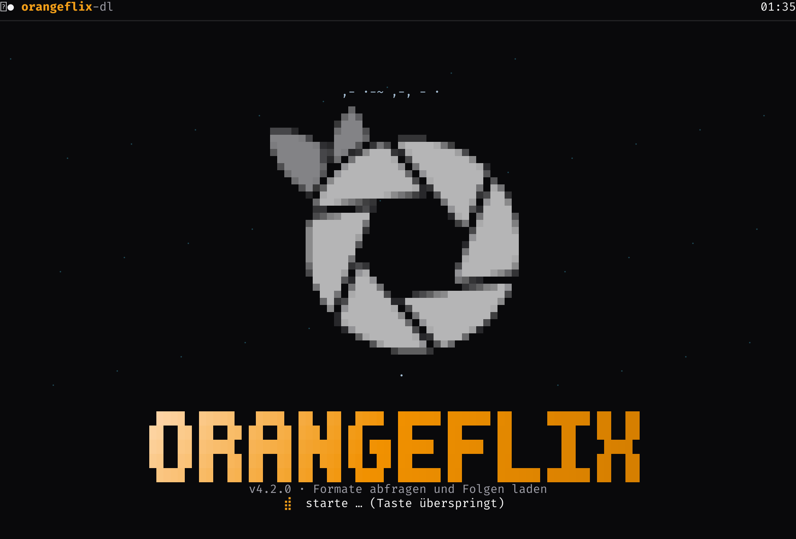

Das Intro mit dem Verschlusslogo beim Start.

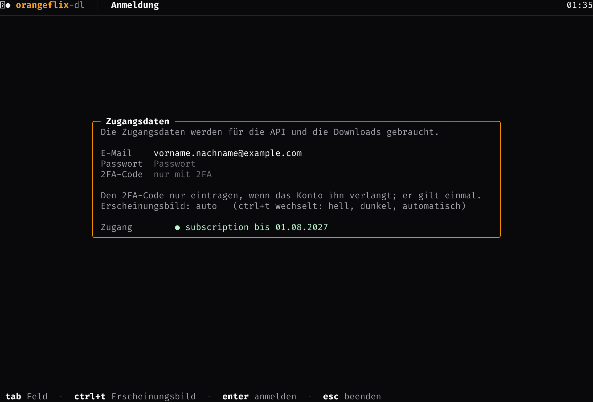

Das Anmeldefenster: E-Mail, Passwort, 2FA-Code und die Wahl des Erscheinungsbilds.

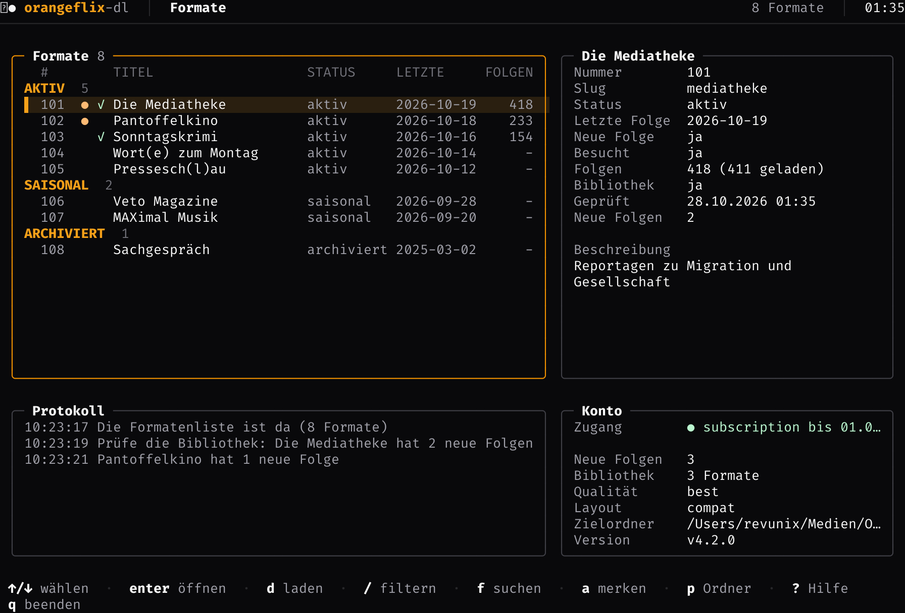

Die Formatenliste; rechts die Angaben zum markierten Eintrag, unten das Protokoll und das Konto.

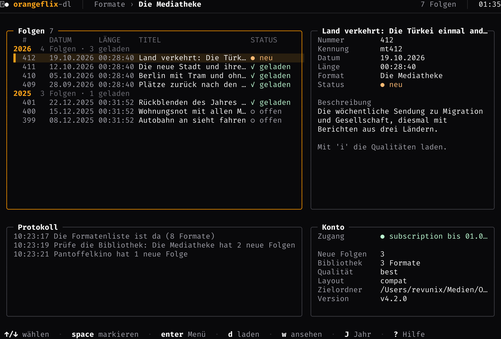

Die Episodenliste des Formats, nach Jahren gruppiert; geladene Folgen tragen das `✓`.

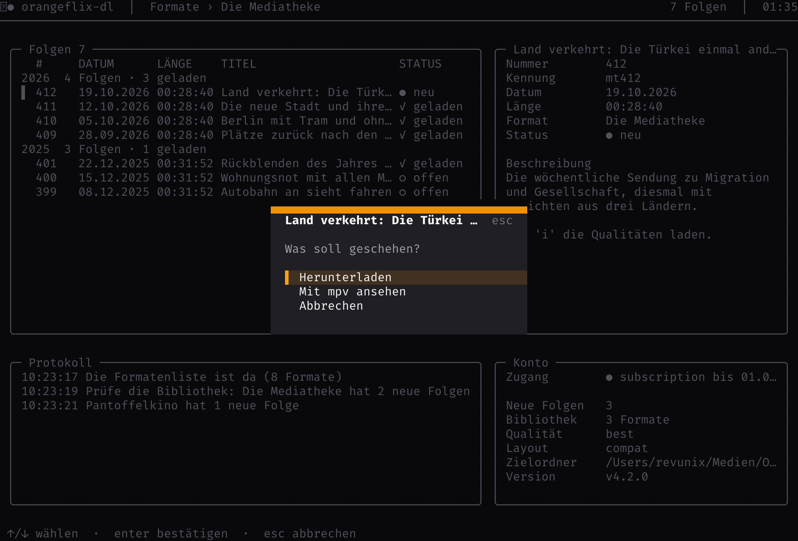

Das Menü beim Klick auf eine Folge: Herunterladen, Mit mpv ansehen, Abbrechen.

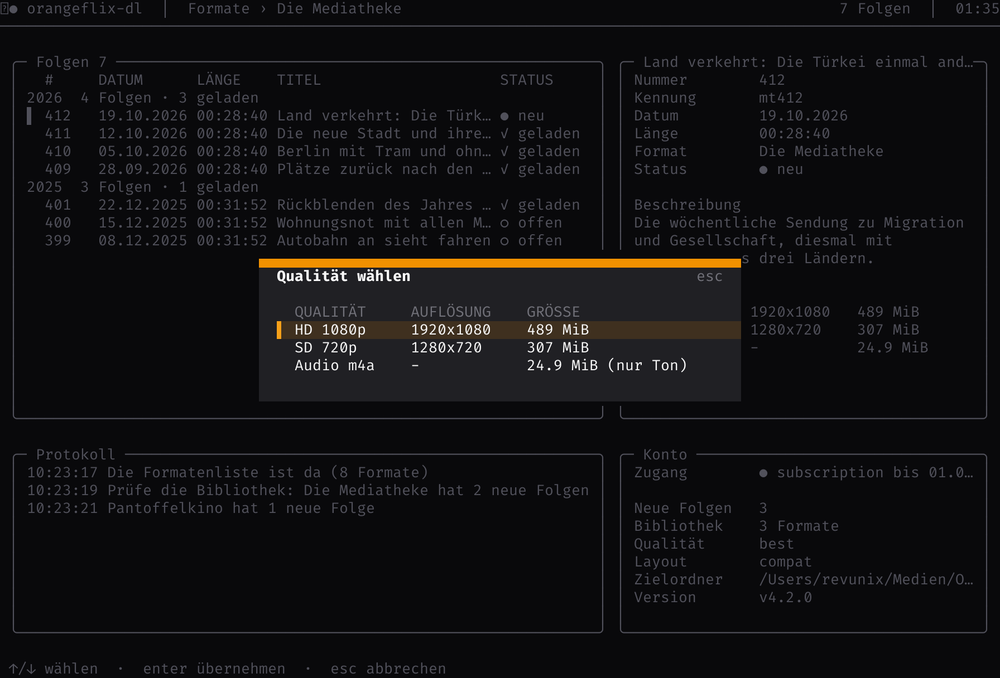

Das Qualitätenfenster ("`i`") mit Auflösung und Dateigröße.

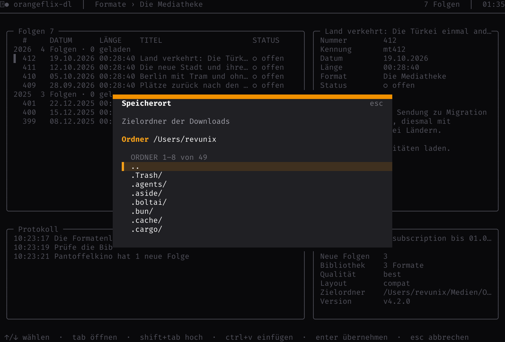

Das Speicherortfenster ("`p`") mit dem Pfad und der Ordnerliste wie im Explorer.

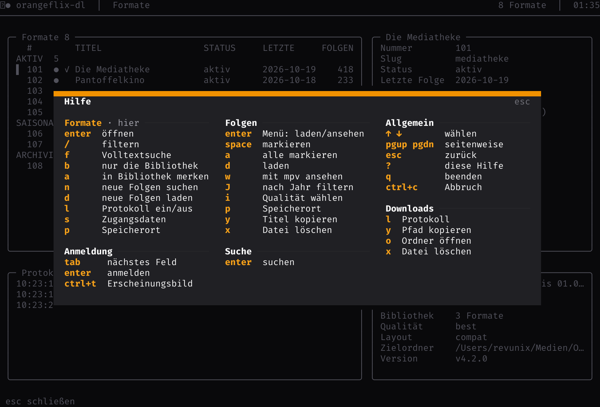

Das Hilfefenster ("`?`"); die Tasten stehen nach Bildschirm gruppiert, die Gruppe des offenen Bildschirms ist mit „hier" markiert.

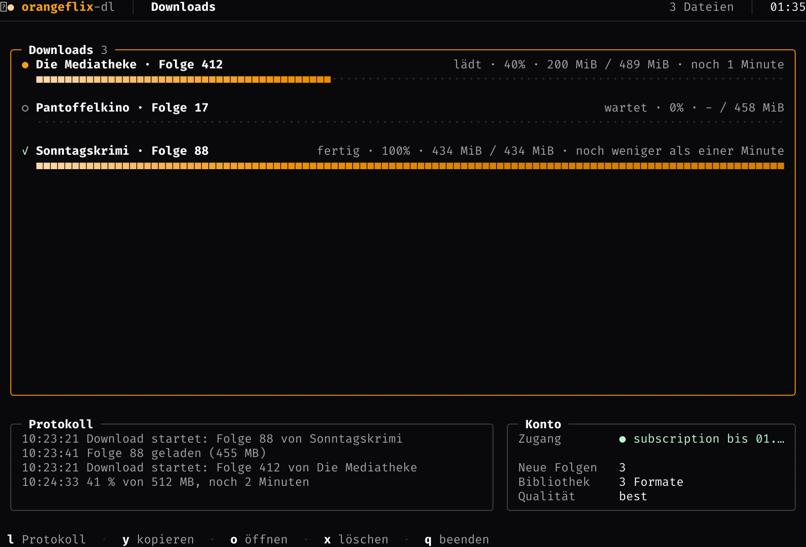

Die Downloadliste mit Fortschrittsbalken, Restschätzung und dem Protokoll darunter.

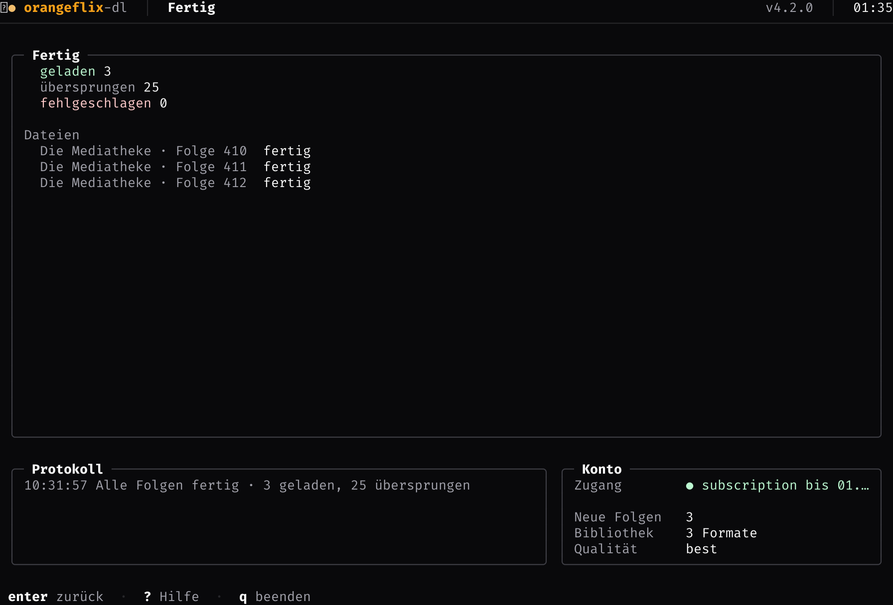

Der Fertig-Bildschirm nach dem Lauf.

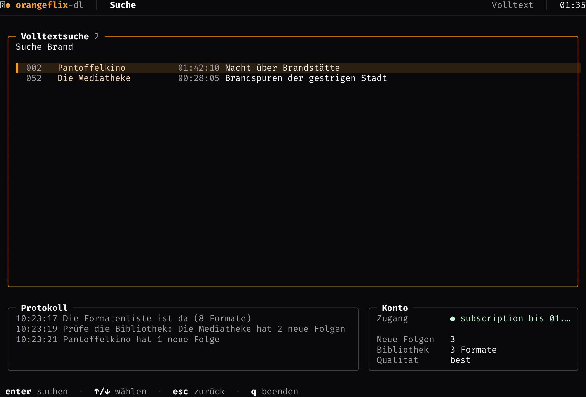

Die Volltextsuche über Titel und Beschreibungen aller Formate.


## Installation

Aus dem Quellbaum:

```bash
git clone <dieses Repository>
cd orangeflix-dl
go build -trimpath -o orangeflix-dl ./cmd/orangeflix-dl
```

Für eine andere Plattform baut Go ohne fremde Werkzeugkette, weil `CGO_ENABLED=0` genügt (SQLite kommt von `modernc.org/sqlite` und braucht kein C):

```bash
# Linux, x86-64 (amd64)
CGO_ENABLED=0 GOOS=linux GOARCH=amd64 go build -trimpath -ldflags "-s -w" -o orangeflix-dl-linux-amd64 ./cmd/orangeflix-dl

# Windows, x86-64
CGO_ENABLED=0 GOOS=windows GOARCH=amd64 go build -trimpath -ldflags "-s -w" -o orangeflix-dl.exe ./cmd/orangeflix-dl

# macOS, Intel
CGO_ENABLED=0 GOOS=darwin GOARCH=amd64 go build -trimpath -ldflags "-s -w" -o orangeflix-dl-darwin-amd64 ./cmd/orangeflix-dl
```

`go tool dist list` nennt alle Paare aus `GOOS` und `GOARCH`; das Release baut `linux`, `darwin` und `windows` jeweils für `amd64` und `arm64`. `-ldflags "-X main.version=v1.2.3"` setzt die Version im Programm.

Alle Plattformen auf einmal baut `build.sh`; es packt die Archive und schreibt die Prüfsummen wie der Release-Workflow:

```bash
./build.sh            # Version aus "git describe", sonst "dev"
./build.sh v1.2.3     # Version im Binary und im Dateinamen
```

Ergebnis in `dist/`: `orangeflix-dl_<version>_<os>_<arch>.tar.gz` (Windows: `.zip`), dazu `checksums.txt` zum Prüfen mit `sha256sum -c checksums.txt`.

## Verwendung

```bash
orangeflix-dl [Optionen]
orangeflix-dl [Optionen] --format <format> [--episode <n> | --range <a-b> | --year <jjjj> | --since <datum> | --title <text> | --all]
orangeflix-dl --library | --check | --download-new | --add <format>
orangeflix-dl --links-file <datei>
```

| Option | Beschreibung |
|--------|--------------|
| `--list` | Alle Formate mit ihrem Status auflisten |
| `--format <format>` | Format wählen: Slug (`mediatheke`), Name (`Die Mediatheke`) oder Nummer (`23`) |
| `--episode <n>` | Eine einzelne Folge laden |
| `--range <a-b>` | Einen Bereich von Folgen laden |
| `--year <jjjj>` | Alle Folgen eines Jahres laden |
| `--since <datum>` | Alle Folgen ab dem Tag laden (YYYY-MM-DD) |
| `--title <text>` | Alle Folgen laden, deren Titel den Text enthält |
| `--all` | Alle Folgen des Formats laden |
| `--quality <q>` | `best` (Standard), `hd` (1080p), `sd` (niedrigste), `mobile` (720p), `audio` |
| `--layout <layout>` | `compat` (Standard) oder `flat` |
| `--parallel <n>` | Bis zu n Downloads gleichzeitig (1-8, Standard 1) |
| `--delay <s>` | Pause zwischen zwei Downloads in Sekunden |
| `--thumb` | Vorschaubild als `.jpg` neben das Video legen |
| `--meta` | Metadaten als `.json` neben das Video legen |
| `--totp <code>` | Aktueller Code des zweiten Faktors, wenn das Konto ihn verlangt |
| `--library` | Die gemerkten Formate auflisten |
| `--json` | Die Ausgabe als JSON (mit `--library` oder `--list`) |
| `--check` | Alle gemerkten Formate auf neue Folgen prüfen |
| `--download-new` | Prüfen und die neuen Folgen laden |
| `--add <format>` | Ein Format merken, ohne es zu laden |
| `--automatic` | Ohne Rückfragen laufen |
| `--links-file <datei>` | Formate aus einer Datei lesen (Batch-Modus) |
| `--force-redownload` | Vorhandene Dateien verwerfen und erneut laden |
| `--watch` | Die Folgen mit mpv ansehen statt herunterladen |
| `--search <text>` | Die Volltextsuche über alle Formate starten |
| `--profile` | Den Abo-Stand anzeigen (Stufe und Ablaufdatum) |
| `--completions <shell>` | Kompletionsskript ausgeben: `bash`, `zsh` oder `fish` |
| `--man` | Die Manpage ausgeben (`orangeflix-dl --man > orangeflix-dl.1`) |
| `-h`, `--help` | Die Hilfe anzeigen |
| `-v`, `--version` | Die Version anzeigen |

Beispiele:

```bash
# alle Formate auflisten
orangeflix-dl --list

# die neueste Folge der Mediatheke in HD laden
orangeflix-dl --format mediatheke --episode 420 --quality hd

# alle Folgen des Jahres 2026
orangeflix-dl --format techload --year 2026

# gemerkte Formate auf neue Folgen prüfen und diese laden
orangeflix-dl --download-new
```

Ohne Terminal startet das Programm im Headless-Modus und fragt die Auswahl am Terminal ab. Mit Terminal startet die TUI.

```bash
# Volltextsuche über alle Formate
orangeflix-dl --search "Mediatheke"

# Abo-Stand anzeigen
orangeflix-dl --profile
```

### API und Anmeldung

Das Programm benutzt die API v3, die auch die Orangeflix-App nutzt:

1. **Anmeldung** über `POST /api/v3/auth/login` mit E-Mail und Passwort. Die Antwort enthält einen Zugriffstoken, der sieben Tage gilt. Der Token landet im Schlüsselbund des Systems und wird bei den nächsten Starts wiederverwendet - das Konto darf nur eine begrenzte Zahl neuer Sitzungen anlegen, deshalb loggt das Programm nur einmal pro Woche ein.
2. **Katalog** über `GET /api/v3/content/magazines` (ohne Token): alle Formate mit Nummer, Titel, Kürzel, Status und der Zahl der Folgen.
3. **Episoden** über `GET /api/v3/content/feed` mit fünfzig Folgen je Anfrage. Fällt die API aus, kommen der RSS-Feed und die alte JSON-API als Rückfall.
4. **Dateien** über `GET /api/v3/playback/{id}`. Die Dateien liegen auf dem Auslieferungsnetz und lassen sich ohne Zugangsdaten laden; der Token steckt in der URL und ist an die Sitzung gebunden.

Ein Konto mit zweitem Faktor meldet die API mit `requiresTotp`; der Code kommt mit `--totp <code>` oder `ORANGEFLIX_TOTP` zum Lauf, im Headless-Modus fragt das Programm ihn sonst an der Konsole ab. In der TUI steht im Anmeldefenster das Feld „2FA-Code“; der Code gilt für genau eine Anmeldung. Verlangt die API einen Code, der fehlt oder nicht angenommen wird, kehrt die TUI ins Anmeldefenster zurück und setzt den Cursor in dieses Feld. Danach liegt der Token im Schlüsselbund, ein neuer Code ist erst nötig, wenn er abläuft oder andere Zugangsdaten eingetragen werden. Das Erscheinungsbild wechselt im Anmeldefenster mit `ctrl+t`.

### TUI

| Bildschirm | Tasten |
|------------|--------|
| Start | `tab` Feld wechseln, `ctrl+t` Erscheinungsbild, `enter` starten, `esc` beenden |
| Formate | `↑`/`↓` wählen, `enter` öffnen, `/` filtern, `f` Volltextsuche, `b` nur die Bibliothek, `a` merken, `n` prüfen, `d` neue Folgen laden, `s` Zugangsdaten, `p` Speicherort, `?` Hilfe, `q` beenden |
| Episoden | `↑`/`↓` wählen, `space` markieren, `a` alle, `enter` Menü (laden oder ansehen), `d` laden, `w` mit mpv ansehen, `i` Qualitäten, `J` nach Jahr filtern, `y` Titel kopieren, `x` Datei löschen, `p` Speicherort, `esc` zurück |
| Suche | `enter` suchen, `↑`/`↓` Treffer wählen, `esc` zurück |
| Downloads | `l` Protokoll, `y` Pfad kopieren, `o` Ordner öffnen, `x` Datei löschen, `q` beenden |
| Fertig | `enter` zurück zu den Formaten |

Die Oberfläche ist ruhig und modern gehalten: neutrale Flächen, eine Akzentfarbe für das, was gerade wichtig ist.

- **Kopfzeile**, ruhig gehalten: links das kleine Zeichen der Marke und `orangeflix-dl` in der Akzentfarbe, nach einem `│` der Pfad zur Ansicht (`Formate › Die Mediatheke`, die aktuelle Stufe fett, die Stufen davor gedämpft) und gegebenenfalls, was gerade lädt; rechts gedämpft der Zusammenhang der Ansicht (z. B. „52 Formate“) und die Uhrzeit. Die Titel der Kästen stehen nur in den Kästen. In schmalen Terminals bleibt links nur `orangeflix`
- **Ein Raster aus Kästen**: oben die Liste (62 % der Breite) und die Angaben zum markierten Eintrag, unten das Protokoll und das Konto. Die Kästen sitzen mit einem Rand von einem Zeichen und füllen ihren Platz ganz aus
- **Dünne Rahmen mit runden Ecken**, der Titel steht oben im Rahmen, eine Zahl dahinter gedämpft (`╭─ Formate 52 ───╮`)
- **Nur die Liste trägt den Akzent**: Ihr Rahmen ist orange, Angaben, Protokoll und Konto treten in einem ruhigen Grau zurück
- **Die markierte Zeile** hat einen orangen Balken `▌` am Rand und eine warme Fläche über die ganze Breite, in den Listen wie in den Fenstern
- **Tabellen**: schlanke Spalten für Nummer, Marker (`●` neue Folge, `✓` schon geöffnet), Status, Datum und Zahl; der Titel bekommt den Rest. Die Spaltenköpfe stehen gedämpft, damit die Zeilen vorne stehen; Gruppen (Status, Jahr) haben einen Kopf in der Akzentfarbe mit den Zahlen dahinter
- **Angaben** als ruhige Liste aus gedämpftem Bezeichner und Wert, leere Angaben hinterlassen keine Lücke
- **Downloads** als Karten: Zeichen des Zustands (`●` lädt, `✓` fertig, `✗` fehlgeschlagen) und Titel, rechts Zustand, Prozent, Größe und Restzeit, darunter der Balken über die ganze Breite und der Pfad
- **Anmeldung** als schmale Karte in der Mitte, die Bezeichner bündig; das aktive Feld trägt den Akzent
- **Die Kästen teilen sich die Fläche der Seite**: Sie haben denselben dunklen Hintergrund wie der Rest, nur der Rahmen trennt sie ab. Alle Grautöne sind feste Farben – Terminals kennen keine Deckkraft
- **Fenster** (Hilfe, Menü der Folge, Qualität, Speicherort) sind randlose Karten mittig über der Seite: eine eigene, gehobene Fläche mit scharfen Kanten aus Halbblöcken und einem schmalen orangen Streifen oben. In der ersten Zeile steht der Titel, rechts gedämpft `esc`; die Tasten stehen nur einmal, in der Fußzeile. Die markierte Zeile hat den orangen Balken und eine warme Fläche, die sich von der Karte abhebt. Über der Seite liegt ein Schleier: Sie bleibt lesbar, aber einfarbig und gedämpft, auch links und rechts neben dem Fenster
- **Fußzeile** mit demselben Rand wie die Kästen: die Taste hell und fett, die Beschreibung gedämpft, Paare durch `·` getrennt; die selteneren Tasten stehen in der Hilfe
- **Meldungen stehen in der Fußzeile**: passt der Text neben die Tasten, steht er rechts mit einem Punkt in der Akzentfarbe (bei Fehlern ein Kreuz in der Fehlerfarbe); ist er zu lang, bekommt er eine eigene Leiste über den Tasten – ein farbiger Balken am Rand und der Text auf eigener Fläche

Unter 100 Spalten zeigt das Terminal nur eine Spalte: die Liste füllt dann die ganze Höhe, die Details und das Protokoll erscheinen über die Tasten `s` (Zugangsdaten) und `l` (Protokoll ein- und ausblenden). `page up` und `page down` scrollen im Protokoll zurück.

Die Formate stehen in einer Tabelle mit Nummer, den Markern „NEU" und „OFFEN", Titel, Status, letzter Folge und der Zahl der Folgen; sie sind nach ihrem Status gruppiert (aktiv, saisonal, archiviert) und **innerhalb der Gruppe nach der letzten Folge sortiert** – das frischeste Format steht oben. „●" in der Spalte NEU bedeutet, dass in den letzten sieben Tagen eine Folge kam (das Alter wird gegen das aktuelle Datum gemessen), „✓" in der Spalte OFFEN, dass das Format schon einmal geöffnet wurde; beides steht auch in den Angaben zum markierten Eintrag. Die Episoden stehen nach Jahren gruppiert mit Nummer, Datum, Länge, Titel und Zustand (geladen, neu, offen). Ab 100 Zeichen Terminalbreite steht neben der Liste eine zweite Spalte mit den Angaben zum markierten Eintrag: bei einem Format Nummer, Slug, Status, letzte Folge, Zahl der Folgen, Bibliotheksstand und Beschreibung, bei einer Folge Nummer, Kennung, Datum, Länge, Beschreibung, Vorschaubild und - mit `i` - die verfügbaren Qualitäten mit ihren Größen. `?` blendet ein Hilfefenster ein: die Tasten stehen nach Bildschirm gruppiert in Spalten, die Taste in der Akzentfarbe links, die Beschreibung daneben. Die Gruppe des offenen Bildschirms steht oben links und ist mit „hier“ markiert. Passt die Hilfe nicht in das Terminal, blättern `↑`/`↓` (bzw. `pgup`/`pgdn`), die untere Rahmenlinie zeigt den Stand; `esc`, `q` oder `?` schließen sie.

### Startbildschirm

Beim Start läuft ein Intro: In der Mitte steht das **Logo von orangeflix.de** mit der Geometrie und dem Ablauf der Website – in Ruhe eine offene, weiße Iris aus sechs Klingen mit zwei Blättern oben links; dann drehen sich die Klingen mit leichtem Überschwingen ineinander, werden orange (`#f19100`), die Blätter werden grün (`#009245`) und drehen sich ein wenig mit: aus der Iris wird eine Orange. Nach einem Moment öffnet sie sich wieder. Das Logo ist aus Halbblöcken gezeichnet, zwei geglättete Pixel je Zeichen, und nimmt die Höhe des Bildschirms. Ein Schwarm Sardinen zieht darum herum und weicht dem Logo aus, darunter steht mittig die Wortmarke im Farbverlauf der Marke. Das kleine Zeichen in der Kopfzeile färbt sich im selben Takt. Eine Taste überspringt das Intro.

Oben links in der Kopfzeile steht das Zeichen klein (`❛●`, Blatt und Frucht) und färbt sich im selben Takt wie das große Logo. Das große Logo ist aus dem SVG der Website nachgebaut: die Klingen sind die Pfade des Originals (Punkte `641.69 271.17`, `1024.39 758.37`, `1205 307.96` mit dem Bogen von 600 Einheiten), auf die Scheibe mit 440 Einheiten beschnitten und um den Drehpunkt der Seite gedreht (`0°` in Ruhe, `38.15°` geschlossen, mit der Kurve `cubic-bezier(.34,1.2,.64,1)`), die Blätter sind die beiden Pfade des `apertureLeafOrbit` der Seite.

### Zugangsdaten

Nach dem ersten Mal wird nichts mehr abgefragt: Das Passwort und der Zugriffstoken liegen im Schlüsselbund des Systems, der Benutzername in der Bibliothek. Der Startbildschirm der Oberfläche entfällt dann. Mit `s` in der Formatenliste lassen sich die Zugangsdaten jederzeit ändern.

Die Zugangsdaten werden in dieser Reihenfolge gesucht:

1. **Umgebungsvariablen** `ORANGEFLIX_USER` und `ORANGEFLIX_PASSWORD` - empfohlen, auch für Docker
2. **Zugangsdaten-Datei** `~/.config/orangeflix-dl/credentials` (Pfad via `ORANGEFLIX_CREDENTIALS_FILE` änderbar, `chmod 600` empfohlen):

   ```ini
   username=meine-mail@example.com
   password=mein-passwort
   ```

   Als Schlüssel akzeptiert die Datei auch `ORANGEFLIX_USER=` und `ORANGEFLIX_PASSWORD=`.
3. **Interaktive Abfrage** im Startbildschirm der TUI

Das **Passwort** wird bevorzugt im Schlüsselbund des Systems abgelegt (macOS Keychain, Windows Credential Manager, Linux Secret Service). Ist keiner erreichbar - etwa im Container -, fällt das Tool auf die Zugangsdaten-Datei zurück.

### Dateinamen

Die Auflösung und das Jahr kommen aus den Metadaten der Folge:

```
Serie:  Die.Mediatheke.S2026.German.AAC.DOKU.1080p.Web-DL.x264/
            Die.Mediatheke.S2026E420.German.AAC.DOKU.1080p.Web-DL.x264/
                Die.Mediatheke.S2026E420.German.AAC.DOKU.1080p.Web-DL.x264.mp4
```

Mit `--layout flat` landen die Folgen direkt im Ordner des Formats und tragen die kurzen Namen:

```
Serie:  Die.Mediatheke.S2026/Die.Mediatheke.S2026E420.mp4
```

Beide Layouts werden beim Überspringen geprüft, ein Wechsel lädt also nichts erneut.

Vorhandene Dateien werden übersprungen; fehlende Untertitel einer vorhandenen Folge werden dabei nachgeladen. `--thumb` und `--meta` holen das Vorschaubild bzw. die Metadaten auch für sonst übersprungene Folgen nach. Reißt die Verbindung ab oder kommen zwei Minuten lang keine Daten, setzt das Tool den Download bis zu dreimal fort. Danach bleibt die Teildatei `.part` erhalten und wird beim nächsten Lauf fortgesetzt. Die Prüfsumme des Servers wird verglichen.

### Speicherort

Der Zielordner steht standardmäßig unter `<Arbeitsverzeichnis>/downloads`. Mit `p` in der Formaten- oder Episodenliste öffnet die TUI ein Fenster für den Speicherort: oben steht der Pfad (eintippen oder mit `cmd+v`/`ctrl+v` aus der Zwischenablage einfügen, `~` steht für den Home-Ordner), darunter zeigt eine Liste die Ordner dieses Pfads wie in einem Explorer. `↑`/`↓` wählt, `tab` öffnet den markierten Ordner (`..` führt eine Ebene hoch), `shift+tab` geht eine Ebene hoch, `enter` übernimmt den Pfad, `esc` bricht ab. Versteckte Ordner sind in der Liste enthalten. Der Ordner wird angelegt und geprüft, ob sich hineinschreiben lässt; die Wahl landet in der Bibliothek und gilt auch für spätere Läufe ohne Terminal. `ORANGEFLIX_DOWNLOADS_DIR` hat Vorrang vor dem gespeicherten Ordner.

### Ansehen statt laden

Die Folgen lassen sich auch direkt ansehen, ohne sie herunterzuladen. Ein Klick auf eine Folge (`enter`) öffnet ein Menü mit den Möglichkeiten **Herunterladen**, **Mit mpv ansehen** und **Abbrechen**; `d` lädt direkt, `w` spielt direkt. Markierte Folgen werden alle zusammen geladen oder abgespielt, sonst nur die angeklickte.

Beim Abspielen gibt die Oberfläche das Terminal an [mpv](https://mpv.io/) frei und kommt danach zurück. mpv bekommt die Adresse der Datei direkt vom Auslieferungsnetz – es wird nichts gespeichert.

Ohne Oberfläche geht es auch:

```bash
orangeflix-dl --format mediatheke --episode 420 --watch
orangeflix-dl --format mediatheke --range 400-410 --watch
```

Fehlt mpv, sagt das Programm das und lädt stattdessen nichts. Die alte API braucht die Zugangsdaten im Kopf der Anfrage; das Programm gibt sie mpv als Kopfzeile mit.

### Bibliothek und neue Folgen

Alle Zustandsdaten liegen in einer SQLite-Datei (Standard: `~/.local/state/orangeflix-dl/library.db`, via `ORANGEFLIX_LIBRARY` änderbar):

| Tabelle | Inhalt |
|---------|--------|
| `settings` | Benutzername, Qualität, Speicherort |
| `formats` | die Bibliothek: Nummer, Slug, Titel, Status, aktiv, neue Folgen, letzte Prüfung |
| `episodes` | jede bekannte Folge mit Erstfund und Download-Zeitpunkt |
| `opened` | die Formate, in denen der Benutzer schon war |

Für Zeitsteuerung (z. B. cron) genügt:

```bash
orangeflix-dl --check          # Exit 1, wenn eine Prüfung fehlschlägt
orangeflix-dl --download-new   # lädt nur die neuen Folgen
```

## Umgebungsvariablen

| Variable | Beschreibung | Standard |
|----------|--------------|----------|
| `ORANGEFLIX_USER` | Login-E-Mail | - |
| `ORANGEFLIX_PASSWORD` | Passwort | - |
| `ORANGEFLIX_QUALITY` | Standardqualität | `best` |
| `ORANGEFLIX_LAYOUT` | `compat` oder `flat` | `compat` |
| `ORANGEFLIX_SUBMODULE` | RSS-Feed-Variante | `1` |
| `ORANGEFLIX_DOWNLOADS_DIR` | Zielverzeichnis der Downloads | `<Arbeitsverzeichnis>/downloads` |
| `ORANGEFLIX_LIBRARY` | SQLite-Datei | `~/.local/state/orangeflix-dl/library.db` |
| `ORANGEFLIX_CREDENTIALS_FILE` | Zugangsdaten-Datei | `~/.config/orangeflix-dl/credentials` |
| `ORANGEFLIX_CONFIG_FILE` | Konfigurationsdatei der Vorgaben | `~/.config/orangeflix-dl/config` |
| `ORANGEFLIX_TOTP` | Code des zweiten Faktors | - |
| `ORANGEFLIX_PARALLEL` | Downloads gleichzeitig (1-8) | `1` |
| `ORANGEFLIX_DELAY` | Pause zwischen Downloads (Sekunden) | `0` |
| `ORANGEFLIX_THUMB` | Vorschaubild `.jpg` mitliefern (`1`) | aus |
| `ORANGEFLIX_META` | Metadaten `.json` mitliefern (`1`) | aus |
| `ORANGEFLIX_DEBUG_DIR` | Verzeichnis für die Diagnose-Datei `requests.log` | - |

### Konfigurationsdatei

Dauerhafte Vorgaben stehen in `~/.config/orangeflix-dl/config`, im selben Format wie die Zugangsdaten-Datei:

```ini
quality=hd
layout=flat
parallel=2
delay=0.5
thumb=1
meta=1
downloads_dir=~/mediatek
```

Der Vorrang ist: Kommandozeile, Umgebung, Konfigurationsdatei, Vorgabe. Der in der TUI gewählte Speicherordner ist weiterhin stärker als die `downloads_dir` der Datei.

## Diagnose

Bei einem Problem mit der API oder dem Download hilft `ORANGEFLIX_DEBUG_DIR`: Dort landet `requests.log` mit den Anfragen und den Antworten des Laufs.

```bash
ORANGEFLIX_DEBUG_DIR="$PWD/debug" orangeflix-dl --format mediatheke --episode 420
```

## Docker

```bash
docker build -t orangeflix-dl .
docker run --rm -it \
  --user "$(id -u):$(id -g)" \
  -e ORANGEFLIX_USER=meine-mail@example.com \
  -e ORANGEFLIX_PASSWORD=mein-passwort \
  -v "$PWD/downloads:/data/downloads" \
  -v "$PWD/orangeflix-config:/data/orangeflix-dl" \
  orangeflix-dl --format mediatheke --episode 420
```

Mit `--user` gehören die Downloads und die Zugangsdaten dem eigenen Benutzer statt `root`.

## Entwicklung

```bash
go vet ./...
go test ./... -count=1 -race
golangci-lint run ./...
```

Aufbau: `internal/orangeflix` (API-Client, RSS, Formatkatalog), `internal/config` (Kommandozeile, Zugangsdaten, Pfade), `internal/media` (Dateinamen), `internal/download` (HTTP-Download, Fortsetzung), `internal/store` (SQLite-Bibliothek), `internal/app` (Abläufe), `internal/cli` (Headless-Einstieg), `internal/tui` (Bubble Tea).

## Lizenz

MIT - siehe [LICENSE](LICENSE).
